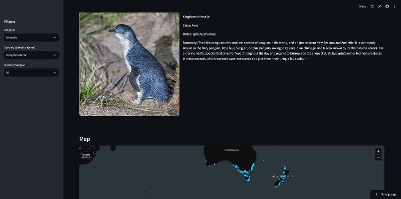
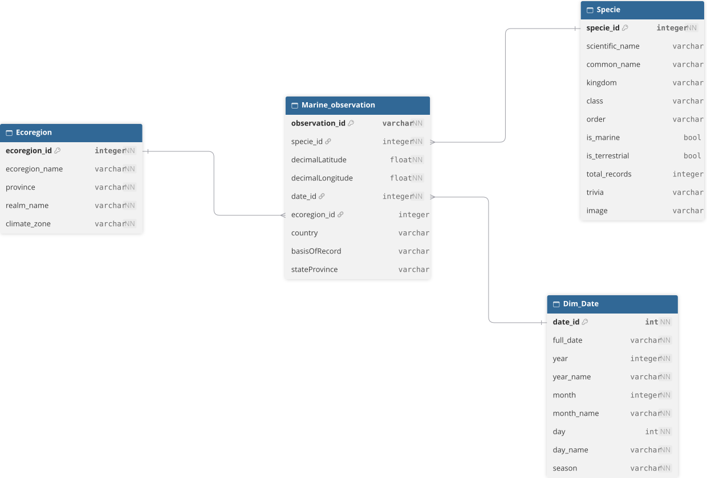

# Okeanos - Marine data pipeline

[](https://www.python.org/)
[](https://duckdb.org/)
[](https://streamlit.io/)
[](https://www.docker.com/)
[](https://en.wikipedia.org/wiki/Star_schema)

## Summary

Okeanos is a data pipeline that extracts and loads marine biodiversity data into an interactive dashboard. 



**Live :** [https://okeanos-marine-data-pipeline.streamlit.app/](https://okeanos-marine-data-pipeline.streamlit.app/)

## Getting started

### Run the main pipeline
```python
python -m src.pipelines.marine_pipeline
```

### Run the daily pipeline (adding new species to the existing database)
```python
python -m src.pipelines.daily_pipeline
```

### Launch Streamlit

```
streamlit run app.py  
```

## Star schema

For enjoyers looking to query the data with SQL, here is the star schema:




## Future improvements

- Adding more attributes for observations (sst, depth, bathymetry...)

## Sources

- [Ocean Biodiversity Information System (OBIS API)](https://obis.org/) : Biological marine occurrences, GPS coordinates
- [Wikipedia API](https://developer.wikimedia.org/fr/build-tools/apis/) : Species encyclopedic trivia and reference images.
- [Spalding, M.D., H.E. Fox, G.R. Allen, N. Davidson, Z.A. Ferdaña, M. Finlayson, B.S. Halpern, M.A. Jorge, A. Lombana, S.A. Lourie, K.D. Martin, E. McManus, J. Molnar, C.A. Recchia, and J. Robertson. 2007. "Marine Ecoregions of the World: A Bioregionalization of Coast and Shelf Areas." BioScience 57, no. 7: 573-583. Accessed through Resource Watch, (date)](www.resourcewatch.org) : Marine Ecoregions of the World